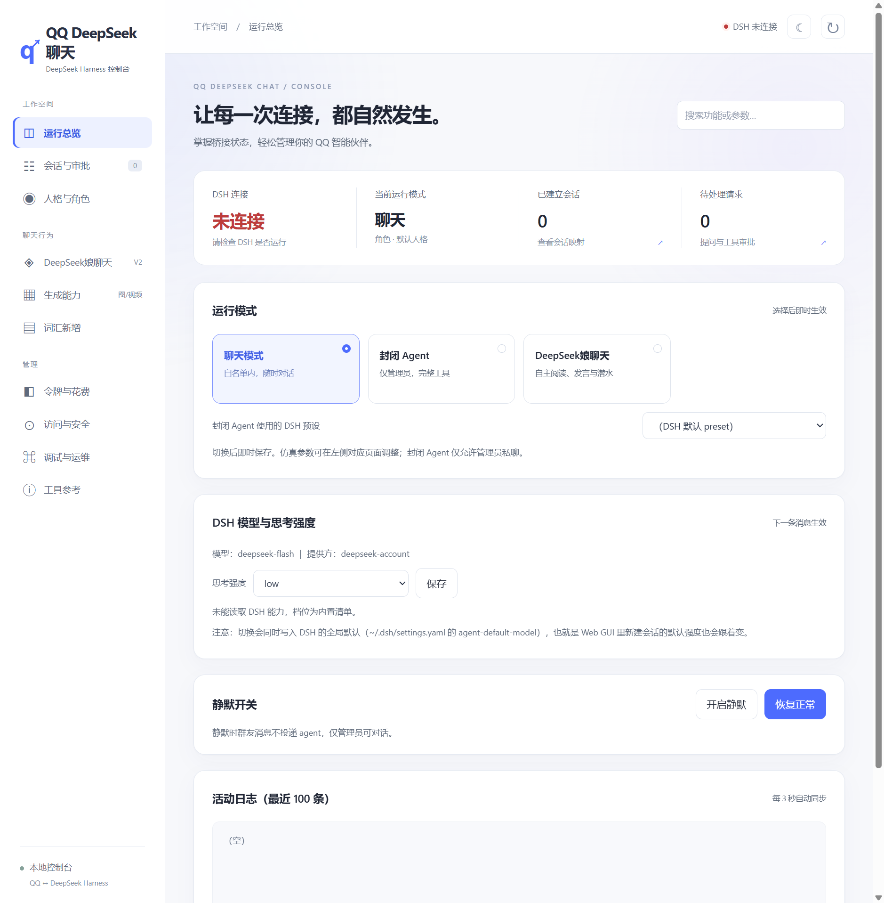
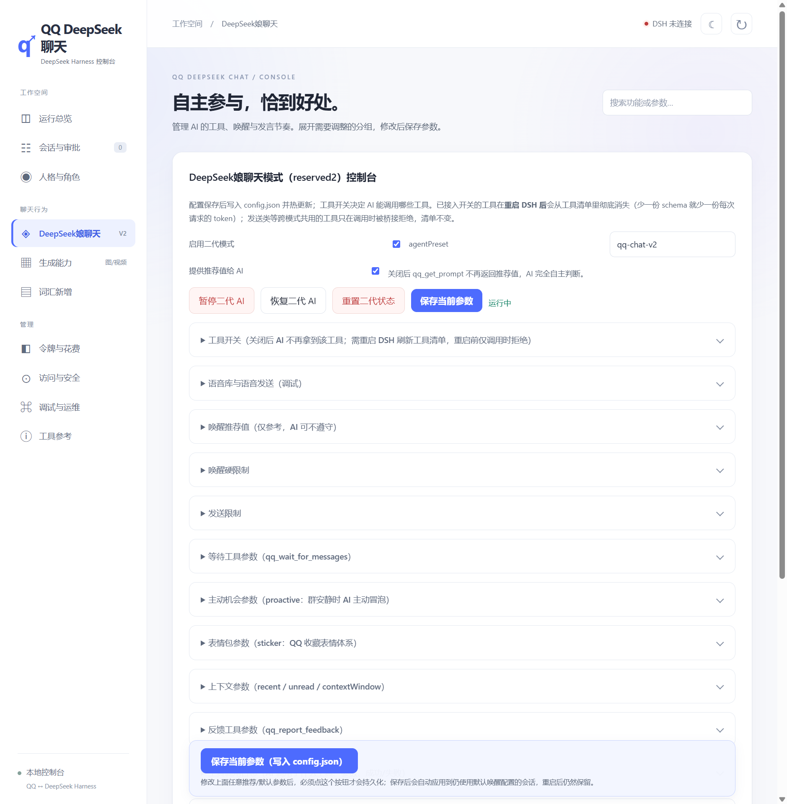
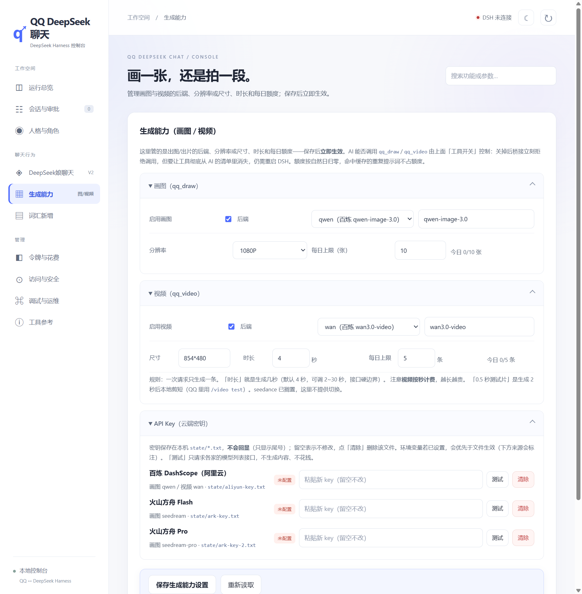
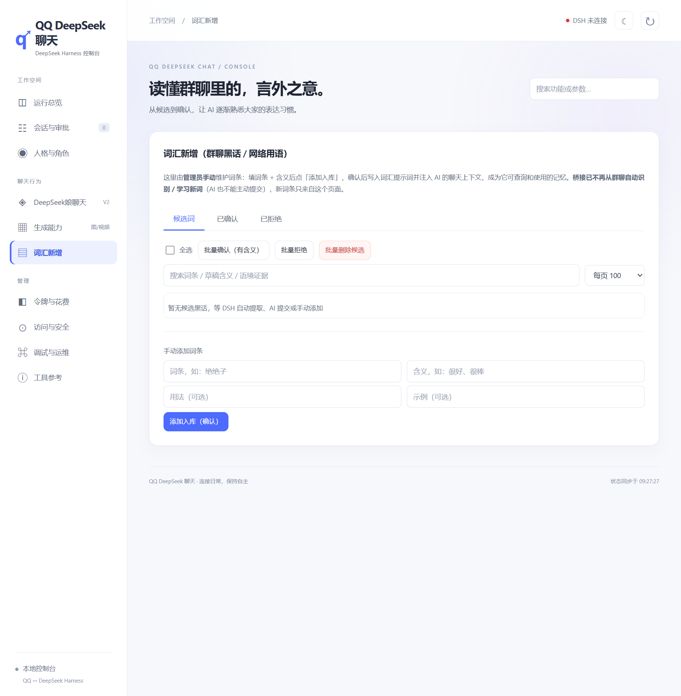

# QQ DeepSeek 聊天（QQ ↔ DeepSeek Harness 桥接）

**English**: [README.en.md](README.en.md) | **中文**: [README.md](README.md)

> 📘 从零部署看 **[docs/guides/DEPLOY.md](docs/guides/DEPLOY.md)**（安装 / 填 Key / 接 SnowLuma+DSH / 使用 / 注意事项 / 排障）；语音与翻唱看 **[docs/guides/VOICE.md](docs/guides/VOICE.md)**。
>
> 🗂️ 文档索引（全部文档一句话说明 + 是否仍然有效）见 **[docs/README.md](docs/README.md)**；仓库目录/脚本命名约定见 **[docs/FOLDER_MAP.md](docs/FOLDER_MAP.md)**。
>
> 🔒 QQ 会话的权限边界与安全承诺见 **[RULES.md](RULES.md)**。
>
> 🎤 独立的「发语音」工具已拆到仓库上一级的 **`../voice-tool/`**（命令行 `voice-cli.mjs` / 图形界面 `voice-gui.mjs`），不再依赖 qq-bridge 运行。

---

## 来源与改动

本项目基于 **[@Derpyu520](https://github.com/Derpyu520) 的 [qq-bridge](https://github.com/Derpyu520/qq-bridge)** 二次开发（MIT License，原始版权声明保留在 [LICENSE](LICENSE)）。
上游作者把「QQ ↔ DeepSeek Harness 桥接」的基础设施做得很完整（OneBot 接入、会话路由、审批转发、MCP 工具面、控制台），这里的工作是在其之上做的取舍与扩展：

| 方向 | 本仓库做的事 |
|---|---|
| 🎤 语音 | 接入阿里云百炼 TTS 与 Seed-VC 换嗓；支持发语音条、朗读、用你的音色说话 |
| 🎵 翻唱 | 新增 `/cover` 与 `qq_cover` 工具：下载/裁剪歌曲 → 人声分离 → 换成目标音色 → 与伴奏混音 |
| 🖼️ 画图 | 接入百炼 Qwen-Image 3.0 与火山方舟 Seedream 5.0（Flash / Pro）三档，可切换分辨率与每日额度 |
| 🎬 视频 | 接入百炼 wan3.0-video / wan3.0-video-prime：让 AI 在 QQ 里出片，支持 2~30 秒、按秒计费与额度保护 |
| 🎛️ 控制台 | 新增「生成能力」页：后端/型号/分辨率/时长/额度/**API Key** 全部可视化，密钥只显示尾号 |
| 📚 词汇（黑话） | **把「群内自动学习黑话」改成只在管理端手动录入**：桥接不再从群聊提取词条，AI 也不能主动提交；已确认词条仍注入上下文 |
| 🧹 其它 | 一代仿真模式下线（只保留二代 `reserved2`）、页面改名「DeepSeek娘聊天 / 词汇新增」、控制台深度重构 |

> 如果你只想要最原始、最精简的版本，建议直接用上游仓库；本仓库包含较多本机化扩展（语音/画图/视频/翻唱），依赖也更多，上手前请先读 [本地部署与使用指南](docs/guides/DEPLOY.md) 和下面的「开箱可用性」。

---


把 QQ 消息接入 DSH agent：QQ 好友/群发来的消息会变成 DSH 会话里的用户消息，agent 的回复（含提问、工具审批）会发回 QQ。

> ⚠️ **当前版本 `0.1.7`**（见 [package.json](package.json)），在 **DSH 0.1.7** 上逐项实测。
> 依赖 DSH 的 Cookie 鉴权、斜杠 RPC（`/api/<namespace>/<method>`）与 `/api/remote.mux` 事件流；这套协议自 DSH `0.1.2-alpha.1` 起引入，**与更早的点号 endpoint 协议不兼容**。
>
> 与上游相比的差异（一代仿真下线、默认模式 `reserved2`、新增语音/画图/视频/翻唱与「生成能力」控制台）见上文 [来源与改动](#来源与改动)。
>
> 默认分支 `main` **就是**本版本，`git clone` 直接拿到，无需切换分支。

```
QQ 消息 ──► SnowLuma（OneBot v11 WS）──► 本桥接进程 ──► DSH Web API (127.0.0.1:3080/api)
                                                ▲                      │
                                                └── agent 回复/提问/审批 ┘
```

> **第一次部署？** 先看 [本地部署与使用指南](docs/guides/DEPLOY.md)——从装 Node 到在 QQ 里发第一条消息，含费用/安全/缺件清单。

## 项目展示

控制台（演示实例，未填 Key、无任何个人数据）：

| 运行总览 | DeepSeek娘聊天 |
|---|---|
|  |  |

| 生成能力（画图 / 视频 / API Key） | 词汇新增 |
|---|---|
|  |  |


> 视频改由 **Release 附件**托管，不在仓库里——只想安装桥接的人不必再下载这 11 MB（它此前占整个仓库体积的 88%）。

## 架构

- **QQ 侧**：`@snowluma/sdk` 的 `SnowLumaWebSocketClient`（OneBot v11 WebSocket 客户端，自动重连）
- **DSH 侧**：适配 DSH 0.1.2 起、0.1.7 复核通过的协议——launch token 换 Cookie 鉴权、`/api/<namespace>/<method>` 斜杠 RPC、`/api/remote.mux` + `session/follow` 事件流；复用 `AbstractApiClient` 传输层但不再依赖旧版 zod value schema。会话模型由桥接按 `config.json` 的 `dsh.model` 逐会话 `session.selectModel` 固定（默认 `deepseek-flash` = DeepSeek-V41-Flash，多模态）
- **agent 自主收发 QQ**：DSH 的 MCP 客户端（`~/.dsh/profiles/web/cordis.patch.yml` 配置）接入三个 MCP server：
  - `snowluma`（桥接自带 `src/mcp-snowluma-safe.js`）：QQ 动作**安全子集**（查状态/查群/查消息/发消息，发送强制白名单；发送工具支持可选 `replyToMessageId` 引用回复）
  - `snowluma-host`（桥接自带 `src/mcp-host-server.js`）：**只有** `snowluma_status`（只读探活 `get_login_info`）。
    ⚠️ **本仓库已移除 `start_snowluma` / `stop_snowluma` 工具**（沿用上游 0.1.5 的决定；`snowluma.allowProcessControl` 配置项同时废弃）——
    原因是 **SnowLuma EULA §5.4** 规定「将其并入第三方安装包或 Docker 镜像、**通过自动化脚本部署**」
    须事先取得书面授权，而原生组件属专有组件。本程序**只探测、不部署**：SnowLuma 的安装、启动与扫码
    始终由你自己完成（详见 [LICENSE](LICENSE) 与 [RULES.md](RULES.md)）。
  - `web-search-safe`（桥接自带 `src/mcp-web-search-safe.js`）：只读 `web_search` / `web_fetch`（带 SSRF 防护），供 agent 查网络用语/资料。
    ⚠️ 它会把**搜索关键词发给 Bing**、并按模型决定抓取公网 URL。（词汇库的自动学习已移除：桥接不再从群聊提取词条，只由管理员在「词汇新增」页手动录入。）
    数据出机清单见 [LICENSE](LICENSE) 的「数据出机清单」。
- **会话模型**：每个 QQ 会话（私聊/群）对应一个独立的 DSH 会话，统一归组到「QQ 聊天」工作区（不再散落未分组）；映射持久化在 `state/sessions.json`
- **性格定制**：QQ 会话默认使用 `qq-chat` agent preset（`~/.dsh/.agent-presets/qq-chat/agent.cordis.yml`），`reserved2` 使用 `qq-chat-v2`（`~/.dsh/.agent-presets/qq-chat-v2/agent.cordis.yml`）；人格与默认 DSH 一致（coding agent），仅附加 QQ 场景规则；**角色扮演**是可选机制——由控制台或管理端设置 `state/current-role.json` 注入（群友无法更改）
- **本地控制台**：桥接自带 Web 控制台 `http://127.0.0.1:3100`——左侧按操作任务分为「运行总览 / 会话与审批 / 人格与角色 / DeepSeek娘聊天 / 生成能力 / 词汇新增 / 令牌与花费 / 访问与安全 / 调试与运维 / 工具参考」十个页面，右上角搜索框可跨页定位任意功能项；支持**浅色 / 深色双主题**（顶栏一键切换，未选择时跟随系统）；切换运行模式（chat / closed-agent / reserved2）、设置角色、静默开关、查看活动日志、修改管理员/控制台令牌，全部即时生效；访问需要令牌（`config.json` 的 `consoleToken`，未配置时自动生成并打印在启动日志；控制台内可手动修改或重新生成）
  - **令牌与花费看板**：实时显示 AI 的 token 消耗与折算金额（元），可下钻到**每个群 / 每个好友 / 每一轮对话**（轮次、步数、缓存命中/未命中输入、输出、命中率、花费、峰谷时段），并有**按时间的消耗走势图**（24 小时 / 3 天 / 7 天 / 30 天，柱子按高峰/空闲着色，一眼看出什么时候烧得凶、哪几个小时是 2 倍价）。累计总量取自 DSH 的 `tokenUsage` 投影（精确，含桥接启动前的历史），逐轮明细由 `assistant/message` 的 `usage` 折叠而来；金额按 DeepSeek 官方价目表折算并区分**高峰 / 空闲时段**（高峰单价为空闲的 2 倍，已内置中国法定节假日）。详见 [docs/guides/TOKEN_USAGE_CONSOLE.md](docs/guides/TOKEN_USAGE_CONSOLE.md)
  - **人格（角色扮演）管理**：列表点选即可载入查看/编辑提示词，支持新建、保存修改、改名（自动重命名文件）、另存为副本、删除；超过注入上限或含一代专用指令会实时提示
  - **两层提示词可分别查看与修改**：「仿真提示词」（预设内置，管行为与协议，保存后同步到 DSH，需重启生效）与「人格提示词」（`roles/*.md`，管人设与语气，保存即生效）；仿真层保存前做安全不变量校验与自动备份，可一键还原
  - **DSH 思考强度**：默认 `max`，可选 `high` / `low`，档位从 DSH 实际公布的能力读取，保存后下一条消息生效；控制台会明示该设置同时写入 DSH 全局默认（`~/.dsh/settings.yaml`）
- **运行模式**：
  - `chat`：白名单群 + 白名单私聊 → qq-chat 安全聊天
  - `closed-agent`：仅私聊 owner（config.json 的 ownerQQ，可在控制台设置）→ 完整工具（默认用 DSH 自己声明的默认 preset，即 `standard`；可在控制台「closed-agent preset」下拉改为任意 DSH preset），可在 QQ 上操控 DSH
  - ~~`reserved`（一代仿真）~~：**已于 2026-10-23 下线**（入口、预设、配置、控制台页面与专属代码全部移除）。历史设计见[上游仓库](https://github.com/Derpyu520/qq-bridge)的 `docs/design/`
  - `reserved2`（DeepSeek娘聊天，运行 `setup-dsh.mjs` 后 DSH 默认）：文本不自动转发，AI 通过 `qq_get_unread_messages` / `qq_send_message` 等工具自主看消息、发言、等待、设置唤醒/潜水；DSH 端使用 `qq-chat-v2` preset
- **交互增强**：
  - agent 通过 `ask_user_question` 提问时，问题会转发到 QQ，回复即自动应答
  - agent 请求工具审批时，转发到 QQ，回复「通过」/「拒绝」即可决策
  - 支持 DSH 斜杠命令（如 `/model`）与 `/reset`（重置会话上下文）
  - 群聊引用/回复会解析成「被引用人 + 原文」注入 DSH（如 `[引用 Derp：El Psy Kongroo是啥]机关的走狗`），让 AI 判断这句话是对谁说的，不会把群友之间引用第三方的对话误当成指向自己；引用机器人自己时会被视为必回
  - MCP 发送工具支持可选 `replyToMessageId`，并新增专用 `qq_reply` 工具：AI 可以先用 `qq_get_group_history` 拿到真实消息 id，再引用/回复某条消息（是否允许 AI 主动使用由人格/策略决定；桥接会检测发送类工具调用并自动跳过该回合的重复自动转发）
  - ~~一代仿真模式（`reserved`）下，AI 可以只输出 `[SILENT]` 表示"潜水/不接话"~~（模式已下线；`reserved2` 用 `qq_wait_for_messages` / 不发言来表示潜水）
  - ~~一代仿真模式（`reserved`）按空格分句~~（模式已下线；`reserved2` 分条请用 `qq_send_message` 数组）

## 前置条件

1. 运行中的 DeepSeek Harness Web（默认 `http://127.0.0.1:3080`）
2. 运行中的 SnowLuma，且配置好 OneBot WebSocket 与 HTTP API（默认 `ws://127.0.0.1:3001` / `http://127.0.0.1:3000`，`accessToken` 视配置填写）
3. Node.js ≥ 22.13

## 安装与配置

```bash
npm install        # 安装依赖（postinstall 会自动修补 @snowluma/sdk 的 ESM 打包 bug）
```

复制 `config.example.json` 为 `config.json` 后编辑：

> Windows CMD 用户请用：`copy config.example.json config.json`

> ⚠️ 真实 `config.json` 与 `state/` 不会进入公开仓库，仓库只提供脱敏的 `config.example.json` 模板。

| 字段 | 说明 |
| --- | --- |
| `dsh.baseUrl` | DSH Web 地址，默认 `http://127.0.0.1:3080` |
| `dsh.provider` / `dsh.model` / `dsh.reasoningEffort` | DSH 会话使用的模型/推理强度；若你的 DSH 没有示例中的模型，改成 DSH 设置页里可用的模型即可（选择失败只打日志，不阻塞启动） |
| `dsh.authToken` | DSH launch token（新版 DSH 用于换取 Cookie 的进程启动 token）。留空时桥接会自动从 `~/.dsh/guard/logs/server-*.out.log` 发现；DSH 重启后遇到 401 也会自动重新发现并换 Cookie |
| `dsh.authHeader` / `dsh.authPrefix` | 保留字段，当前新版 DSH 链路使用 Cookie 交换，不再直接发送该鉴权头 |
| `snowluma.wsUrl` | SnowLuma OneBot **WebSocket** 地址（如 `ws://127.0.0.1:3001`） |
| `snowluma.httpUrl` | OneBot **HTTP API** 地址（如 `http://127.0.0.1:3000`）；不要填 WebSocket 端口，否则会报 HTTP 426 |
| `snowluma.accessToken` | OneBot accessToken，未配置留空 |
| `snowluma.launcherPath` / `homeDir` | SnowLuma 启动脚本与安装目录（供 agent 自动启动/停止） |
| `agentPreset` | QQ 会话使用的 DSH agent preset，默认 `qq-chat`（改性格见下文） |
| `socialV2.agentPreset` | `reserved2` 模式使用的 DSH agent preset，默认 `qq-chat-v2` |
| `workspaceTitle` | QQ 会话在 DSH 界面中的归组名称，默认「QQ 聊天」 |
| `allow.private` / `allow.groups` | 白名单（QQ 号/群号数组）；留空且 `allowAllWhenEmpty: true` 时放行全部 |
| `deny.*` | 黑名单，优先于白名单 |
| `ackMessage` | 消息投递后的立即回复，空字符串关闭 |
| `sendDelayMs` | QQ 连续发送间隔，防止触发频率限制 |
| `consolePort` | 本地控制台端口，默认 `3100` |
| `consoleToken` | 控制台访问令牌；留空时启动自动生成并保存到 `state/console-token` |

> ⚠️ `allowAllWhenEmpty: true` 表示「白名单没填就全部放行」——把 agent 接入 QQ 等于把账号控制权交给了模型，建议先填白名单。

### DSH 端安装（必做：装 preset + 挂 MCP）

桥接和控制台能跑起来还不够，DSH 端还需要安装两个聊天 preset（`qq-chat` / `qq-chat-v2`）并挂载 MCP。**单机新装同样必须执行这一步**（不是只有「另一台设备」才需要），装完还要**重启 DSH**：

```bash
node scripts/setup-dsh.mjs
```

> 全新环境下脚本会把 DSH 默认模式设为 **`reserved2`（DeepSeek娘聊天）**，并创建本地 `state/mode.json` 兜底；这样 AI 使用 `qq_send_message` 等工具收发消息时，DSH 会自动使用 `qq-chat-v2` 模式。如果本机已存在旧的 `state/mode.json` 或 DSH 设置值，脚本会保留不覆盖。之后可在**桥接控制台**（默认 `http://127.0.0.1:3100`）顶部按钮切换模式，控制台会同时写入 DSH 设置与本地兜底文件。

详细步骤见 **[docs/guides/DSH_SETUP.md](docs/guides/DSH_SETUP.md)**。

## 完整启动流程（从零开始）

共 6 步。DSH 已安装并运行，缺的是 SnowLuma 本体 + 桥接侧的 DSH 端安装（**第 2、3 步最容易漏，漏了 QQ 上会毫无反应**）：

1. **DSH**（已运行，无需操作）
   确认 `http://127.0.0.1:3080` 能打开即可。

2. **装桥接并复制配置**
   ```bash
   git clone https://github.com/firefly575/qq-bridge-pro.git
   cd qq-bridge
   npm install
   ```
   Windows CMD 用 `copy config.example.json config.json`，其他平台用 `cp config.example.json config.json`。
   **示例模板里 `allow.private` / `allow.groups` 是空数组**——空白名单 + `allowAllWhenEmpty: false` 时桥接不响应任何消息（这是刻意的 fail-closed 默认值）。白名单在第 5 步填。

3. **装 DSH 端（preset + MCP），然后重启 DSH**
   ```bash
   node scripts/setup-dsh.mjs
   ```
   装完**必须重启 DSH**——preset 与 MCP 只在 DSH 启动时加载。
   跳过这步桥接不会崩，但群聊会话拿不到 `qq-chat` preset，桥接会**拒绝建会话**（有意的安全设计：绝不回退到带 bash/文件工具的默认 preset），表现同样是 QQ 上没反应。

4. **下载并解压 SnowLuma**
   - 下载：<https://github.com/SnowLuma/SnowLuma/releases/latest> 选 `SnowLuma-v<版本>-win-x64.zip`（完整版，自带 Node 运行时；Lite 版需本机 Node 22.13+）
   - 解压到任意目录（例如 `C:\SnowLuma`），双击 `launcher.bat`

5. **首次引导（WebUI）+ 填写桥接配置**
   - 打开启动日志里的 WebUI 地址（README 写的是 `http://localhost:5099`，以你启动日志里实际打印的为准）
   - 用**启动日志中的初始密码**登录，按引导：同意条款 → 设置密码 → 接入 QQ 进程（扫码登录）
   - 在 WebUI 里配置 OneBot 连接：开启 **WebSocket 服务端** 和 **HTTP API**，分别记下**端口**（默认 WS `3001`、HTTP `3000`）和 **accessToken**（若配置了）
   - 回到 `config.json` 填好 `snowluma` 段，并把 `allow.private` / `allow.groups` 换成**你自己的 QQ 号 / 群号**：

     ```json
     "snowluma": {
       "wsUrl": "ws://127.0.0.1:3001",
       "httpUrl": "http://127.0.0.1:3000",
       "accessToken": "你在 WebUI 里配置的 token（没配置就留空）"
     }
     ```

   `wsUrl` 是 OneBot **WebSocket** 端口，`httpUrl` 是 OneBot **HTTP API** 端口（不要填成同一个 WS 端口，否则 MCP 工具会报 HTTP 426）。

6. **启动桥接**
   ```bash
   npm start          # 前台运行（崩溃不自动重启）
   ```
   看到 `SnowLuma 已连接` 即成功；然后 QQ 上给机器人账号发条消息测试。
   Windows 想要「崩溃自动重启」请改用 `start.bat`（见下节）。

## 运行与运维

```bash
npm start          # 或双击 start.bat（守护模式：崩溃自动重启，关闭窗口即停止）
```

**⚠️ 重要**：
- **桥接只能运行一个实例**（有单实例锁，重复启动会被拒绝并提示"已有实例在运行"）
- **用 start.bat 启动**（守护模式），窗口别关——桥接崩溃会在 5 秒后自动拉起
- 桥接异常/消息无反应时：双击 `restart.bat`（自动杀旧实例 → 清理锁 → 重新启动守护）
- **重启 DSH 通常不需要动桥接**：每 5 秒探活，DSH 不可用期间收到的 QQ 消息在桥接进程内排队（最多 50 条/会话，满后丢最旧项），恢复后尝试补投。桥接进程退出会丢失内存队列；断线期间已经结束的回复暂不保证补发。
- 修改 `config.json` / `roles/` / `state/current-role.json` 后重启桥接生效；修改 `~/.dsh/.agent-presets/qq-chat*/` 或 MCP 配置后重启 DSH 生效

日志示例：

```
12:00:01 [bridge] SnowLuma 已连接：ws://127.0.0.1:3001
12:00:02 [bridge] 新会话 private:12345678 -> sess_xxxx
12:00:02 [bridge] 已投递 private:12345678: 你好
12:00:20 [bridge] agent 回复 (private:12345678) 42 字
```

## 自测（不需要 SnowLuma / QQ）

离线回归（使用临时目录和模拟服务，不读取真实配置、不发 QQ 消息）：

```bash
npm run test:audit
```

reserved2 的 token 开销优化与消息水位协议说明，见控制台「令牌与花费」页与 [docs/guides/TOKEN_USAGE_CONSOLE.md](docs/guides/TOKEN_USAGE_CONSOLE.md)。专项离线回归可运行 `npm run test:token`，已包含在上面的完整回归中。

控制台「令牌与花费」看板的账本与价目表回归（峰谷分时、幂等折叠、基线合并、压缩与容错）：

```bash
npm run test:tokens        # 单元测试
npm run test:console-ui    # 离线浏览器回归（含看板渲染与逐轮下钻）
```

本仓库未随附上游的内部分析与审计报告（`docs/audits/`、`docs/design/`、`docs/research/`），需要追溯请看[上游仓库](https://github.com/Derpyu520/qq-bridge)。

验证 DSH 侧链路是否打通（会创建一个独立测试会话，不影响现有会话）：

```bash
npm run self-test
```

预期输出：连接成功 → 测试会话创建 → prompt 被接受 → 打印 agent 回复。

## 目录结构

```
qq-bridge/
  config.example.json   # 配置模板（脱敏占位符；真实 config.json 不入库）
  README.md / README.en.md / RULES.md   # 根目录只留这三个文档，其余全在 docs/
  docs/
    README.md           # 文档索引（每篇一句话 + 是否仍然有效）
    FOLDER_MAP.md       # 目录结构与 scripts/ 命名约定
    guides/             # 面向使用者/运维：DEPLOY / DSH_SETUP / VOICE / TOKEN_USAGE_CONSOLE / SECURITY_BASELINE / PRIVACY
    design/             # 设计与规划：GEN2_SIMULATION_PLAN / SOCIAL_MODE_PLAN / DSH_QQ_TOOLS_PLAN / 真人语感策略
    research/           # 调研：SnowLuma功能调研 / QQ消息免打扰 / 表情包能力 / 本地模型选型
    audits/             # 审查与优化报告（体检、控制台、token）
    legacy/             # 历史归档（已被取代或问题已全部修复的旧报告）
  audio/                # 语音库：把准备好的音频放这里，可作 QQ 语音发出（见 docs/guides/VOICE.md）
  dsh/agent-presets/    # qq-chat / qq-chat-v2 的 DSH agent preset 模板
  plugins/qq-mode-console  # DSH 插件：注册 qq-mode 设置命名空间（仅 host 半，UI 卡片未实现）
  src/
    bridge.js           # 主程序
    dsh-client.js       # Node 版 DSH API 客户端（WS 下行）
    md-to-plain.js      # Markdown → QQ 纯文本
    self-test.js        # DSH 侧自测
  scripts/              # 测试/运维脚本（含 postinstall 的 patch-snowluma-sdk.mjs）
    patch-snowluma-sdk.mjs  # 修补 SDK 的 ESM 打包 bug（postinstall 自动执行）
  state/                # 运行时数据（不入库）
```

> 🎤 **独立的「发语音」工具不在这里**：它是仓库上一级的 [`../voice-tool/`](../voice-tool/)（`voice-cli.mjs` /
> `voice-gui.mjs` / `public/voice.html` / `发语音.cmd`）。图形界面双击上一级的「发语音-图形界面.cmd」。
> 它只依赖 SnowLuma，共享内核仍由本仓库 `src/voice-core.js` / `src/snowluma-conn.js` 提供（单一实现）。
>
> ```bash
> cd ../voice-tool
> node voice-cli.mjs status     # 账号/token 自动发现 + 连通性
> node voice-cli.mjs list       # 可发的群聊/私聊 + 语音库
> node voice-cli.mjs            # 交互菜单
> node voice-gui.mjs            # 图形界面（本地小服务 + 浏览器 UI）
> ```

## 开箱可用性（哪些功能要自己补）

克隆下来、填上 API Key，**下面这些立刻能用**；带 ⚠️ 的需要额外准备（仓库里不含对应的大文件/二进制）。

### ✅ 填 Key 即可用

| 功能 | 需要什么 |
|---|---|
| QQ 文字聊天（收发、引用、@、审批转发） | SnowLuma + DSH + `config.json` 的 `ownerQQ` / `allow` |
| 画图 `qwen` / `seedream` / `seedream-pro` | 百炼 Key 或火山方舟 Key（控制台「生成能力」页可填） |
| 视频 `wan` / `wan-prime` | 百炼 Key；`/video test` 另需 ffmpeg |
| 语音回复（TTS） | 百炼 Key + ffmpeg（`aliyun_tts.py` 只用标准库） |
| 表情发送 / 收藏 / 备注 | SnowLuma（表情库初始为空，会随聊天自动积累） |
| 词汇（黑话）注入与查询 | 无（管理员在「词汇新增」页手动录入） |
| 人格卡 | 无（`roles/` 已带 3 个示例） |
| 控制台 10 个页面 | 无 |

### ⚠️ 需要额外准备

| 功能 | 为什么不行 | 怎么补 |
|---|---|---|
| **翻唱 `/cover`** | `cover.py` 默认 `--engine local`，要用 `.venv-demucs/Scripts/python.exe` 和 `SEEDVC_DIR/checkpoints/DiT_seed_v2_*.pth`；仓库里两者都没有，且桥接**不传** `--engine`，所以没有云端回退 | 二选一：① 建 `.venv-demucs` 并装 demucs；② 下载 [seed-vc](https://github.com/Plachtaa/seed-vc) 的 checkpoints，设 `SEEDVC_DIR` 环境变量。参考音放 `audio/ref-voice.wav`（缺失时会用 edge-tts 自动生成一个通用音色） |
| **说话用你的音色** | 同上，但**不会报错**：会降级成「按音高差移调」的近似音（`speak_voice.py` 有兜底） | 同翻唱 |
| **唱歌 `sing_aliyun`** | 需要 numpy + 百炼 Key + ffmpeg | `pip install numpy`，并配好 Key |
| **本地画图 `sdcpp`** | 代码默认路径是 `D:\Apps\sd-cpp\sd-cli.exe` + gguf 模型，仓库没有 | 在 `config.json` 里覆盖 `socialV2.draw.sdCliPath` / `modelPath`，或直接用云端后端 |
| **语音库发音频** | `audio/` 是空目录 | 把音频丢进 `audio/`（或 `audio/voices/`），控制台语音面板即可选 |
| `npm run voice-gui` / `voice-cli` | 指向上一级 `voice-tool/`，**不在本仓库** | 用控制台自带语音面板，或单独装 voice-tool |
| `make-admin-doc.py` | 依赖 python-docx | `pip install python-docx` |
| `autostart.ps1` / `watchdog.ps1` | 本机路径已改成环境变量 | 设 `QQ_EXE` / `SNOWLUMA_DIR` / `FFMPEG_BIN` |
| 聊天历史 / 记忆 / 用量 | `state/` 是空的（刻意不带个人数据） | 自动生成，从零开始 |

### Python 依赖清单

只有「语音相关」的功能需要 Python，聊天/画图/视频不依赖。

```powershell
pip install numpy                    # TTS/唱歌/翻唱都会用
pip install edge-tts gradio_client httpx   # 翻唱（云端 Seed-VC Space）+ 参考音自动生成
pip install yt-dlp demucs            # 翻唱：URL 下载 + 人声分离
pip install pyworld                  # 仅 sing_world.py（非默认唱歌路径）
pip install python-docx              # 仅 make-admin-doc.py
```

### 最小可用路径（3 步）

1. `npm install` + `copy config.example.json config.json`，填 `ownerQQ` / `allow`
2. 控制台「生成能力 → API Key」填百炼 Key（画图 qwen、视频 wan、TTS 都用它）
3. `npm start`，在 QQ 里给机器人发一条消息

翻唱/唱歌等语音能力可以之后再补——不影响聊天、画图、视频。

## 已知限制

- agent 回复在回合结束时一次性发送（不做流式逐字转发）；回复超过 `socialV2.send.maxMessageChars`（默认 500 字，可用 `social.maxReplyChars` 调整）自动按句读/URL 边界分段
- 图片及部分表情可以通过安全下载接入多模态模型；语音/视频以及无法取得图片字节的消息仍使用占位文本
- **发**语音是支持的（独立工具的图形界面 / 命令行 / AI 工具，见 [docs/guides/VOICE.md](docs/guides/VOICE.md)）；但**收**到的语音目前只显示占位文本，不做语音转写入上下文
- **AI 发语音默认关闭**（`socialV2.voice.enabled` 与 `tools.sendVoice` 默认 `false`）：先把音频放进 `audio/`，再到控制台打开开关；你自己发语音不受这个开关影响
- agent 的 Markdown 回复会转成纯文本（链接保留 `文字 (url)` 形式）
- `@snowluma/sdk` 的 npm 发布版存在 ESM 扩展名 bug，本仓库通过 postinstall 补丁修复（见 `scripts/patch-snowluma-sdk.mjs`）

## 合规提醒

SnowLuma 是独立第三方项目，与腾讯/QQ 无隶属关系，仅供学习与技术研究；使用前请阅读其 EULA 与《QQ 用户协议》。
